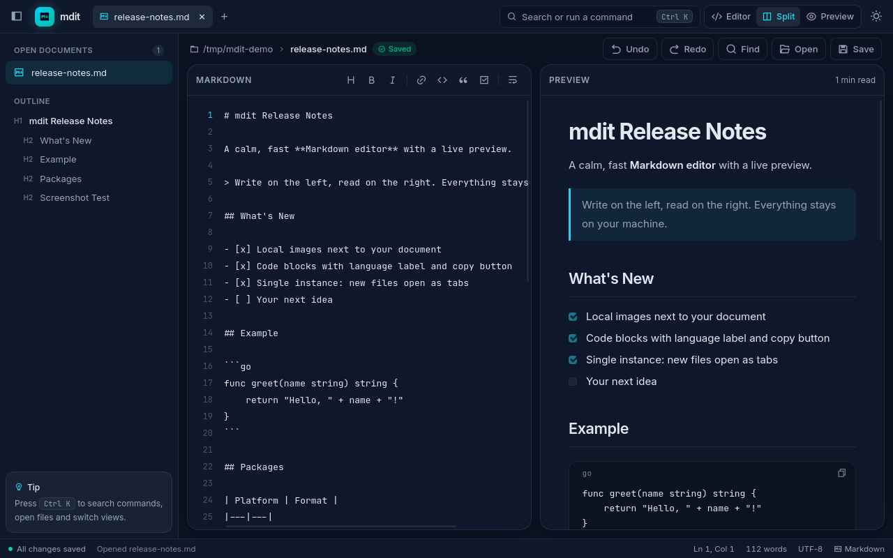

# mdit

## AI SLOP ##

### Disclaimer: This project is 100% AI generated!

-----------------

mdit is a desktop Markdown viewer/editor built with **Go + Wails v2**.



It provides a split-pane workspace:

- left pane: Markdown source editor
- right pane: live rendered preview

Ready-made packages for Windows, macOS and Linux (Flatpak, AppImage, tar.gz) are on the [Releases page](https://github.com/Nilpointer/mdit/releases); see [Installing the packages](#installing-the-packages).

## Features

- Live Markdown rendering with `marked`
- Sanitized preview HTML with `DOMPurify`
- Command palette (`Ctrl K`) for every action, plus keyboard shortcuts
- Open and save Markdown files through native dialogs
- Tabbed Markdown workspace with unsaved-change indicators
- Undo/redo history in the editor, formatting toolbar, line numbers and optional word wrap (`Alt Z`)
- Editor / Split / Preview view modes (`Ctrl E`)
- Sidebar with open documents and a heading outline that jumps both panes
- Find in preview with match highlighting (`Ctrl F`)
- Local images next to your document (relative or absolute paths), see [Local images](#local-images)
- Code blocks show their language and have a copy-to-clipboard button
- Open files from the terminal (`mdit notes.md`) or via "Open with"; `.md`/`.markdown` file associations on Windows, macOS and Linux
- Single instance: opening another file while mdit runs adds it as a tab in the existing window
- Light and dark themes; view, sidebar, theme and wrap preferences are remembered
- Integrated Markdown cheat sheet and about tab (read-only, with "Edit a copy")
- External link opening through Wails browser integration
- Responsive layout for narrower windows

## Keyboard Shortcuts

| Shortcut | Action |
|---|---|
| `Ctrl/Cmd K` | Command palette |
| `Ctrl/Cmd N` / `O` / `S` | New, open, save |
| `Ctrl/Cmd W` | Close tab |
| `Ctrl/Cmd Tab` / `Shift Tab` | Next / previous tab |
| `Ctrl/Cmd Z` / `Y` (or `Shift Z`) | Undo / redo |
| `Ctrl/Cmd F` | Find in preview |
| `Ctrl/Cmd E` | Cycle Editor / Split / Preview |
| `Ctrl/Cmd B` | Toggle sidebar |
| `Alt Z` | Toggle word wrap |
| `F1` | Markdown cheat sheet |
| `Ctrl/Cmd Q` | Quit |

## Local Images

Images stored on disk are shown in the preview:

- Relative paths (`images/pic.png`, `./pic.png`, `../shared/pic.png`) resolve against the folder of the open file. In an unsaved document they appear once the document is saved.
- Absolute paths (`/home/me/pic.png`, `C:\pics\pic.png`) work as written.
- Supported types: png, jpg/jpeg, gif, webp, svg, avif, apng, bmp, ico. Remote (`https://`) and `data:` images work as usual.
- `file://` URLs are not supported; the HTML sanitizer removes them. Use a plain path instead.

`testdata/local-image.md` is a test document covering these cases.

## Tech Stack

- Backend: Go 1.27 + Wails v2
- Frontend: Vanilla JavaScript + Alpine.js + Tailwind CSS v4 + Vite
- Markdown: `marked`
- HTML sanitization: `DOMPurify`
- Icons: Remix Icon

## Project Structure

```text
.
├── app.go                  # Wails backend methods exposed to the frontend (open/save, startup file, OS file opens)
├── localimages.go          # Serves local images to the preview (/mdit-local route)
├── instance_id*.go         # Single-instance ID (separate ID for `wails dev` builds)
├── *_test.go               # Go tests
├── main.go                 # Wails app bootstrap and app options
├── go.mod                  # Go module and Wails dependency version
├── mise.toml               # Pinned Go toolchain and Wails CLI
├── wails.json              # Wails build configuration, version info, file associations
├── Makefile                # Convenience commands for dev/build/clean
├── frontend/
│   ├── package.json        # Frontend scripts and npm dependencies
│   ├── src/                # Frontend application source (main.js, style.css)
│   ├── wailsjs/            # Generated Wails JS/TS bindings
│   └── dist/               # Generated frontend build output
├── build/                  # Platform-specific build assets and packaged output
├── packaging/              # Linux desktop entry, AppStream metadata, icons, Flatpak manifest, AppImage launcher
├── testdata/               # Manual test documents
├── mockups/                # Standalone HTML design mockup of the UI
└── .github/workflows/      # Release workflow
```

Notes:

- `frontend/wailsjs/` is generated by Wails. Do not hand-edit it unless regenerating bindings.
- `frontend/dist/` is generated by Vite during builds and embedded into the Go binary by Wails.
- `build/bin/` contains packaged application output after `wails build`.

## Prerequisites

Install the following before building or running the app:

- [mise](https://mise.jdx.dev/), which installs the pinned Go toolchain and Wails CLI from `mise.toml`
- Node.js and npm
- Platform-specific native dependencies required by Wails

Install Go and the Wails CLI:

```bash
mise install
```

Check your local Wails environment:

```bash
wails doctor
```

Install or update frontend dependencies:

```bash
npm --prefix frontend install
```

## Running in Development

From the repository root, use the Makefile target:

```bash
make dev
```

Equivalent direct Wails command:

```bash
wails dev
```

On Fedora and other systems with WebKitGTK 4.1, add the build tag: `mise exec -- wails dev -tags webkit2_41`.

In development mode Wails starts the Go backend and the Vite frontend dev server together. Besides the desktop window, the app is also served at http://localhost:34115, so you can use it in a browser with the Go backend connected (native file dialogs still open on the desktop). The `wails.json` file controls the frontend commands:

```json
{
  "frontend:install": "npm install",
  "frontend:build": "npm run build",
  "frontend:dev:watcher": "npm run dev",
  "frontend:dev:serverUrl": "auto"
}
```

## Frontend-Only Commands

These commands are useful when working only on frontend assets:

```bash
npm --prefix frontend run dev
npm --prefix frontend run build
npm --prefix frontend run preview
```

The frontend production build writes files to `frontend/dist/`.

## Building the Desktop App

Use the Makefile target:

```bash
make build
```

Equivalent direct command:

```bash
wails build
```

A production build performs the main Wails build steps:

1. Install frontend dependencies if needed.
2. Generate or refresh Wails bindings under `frontend/wailsjs/`.
3. Build frontend assets with Vite.
4. Compile the Go backend.
5. Embed frontend assets into the app.
6. Package the platform-specific desktop application.

Build output is written under:

```text
build/bin/
```

The configured app name and output filename are defined in `wails.json`:

```json
{
  "name": "mdit",
  "outputfilename": "mdit"
}
```

## Cleaning Build Outputs

Remove local generated build outputs:

```bash
make clean
```

This removes:

- `frontend/dist`
- local `mdit` binary, if present

For a clean Wails rebuild, use:

```bash
wails build -clean
```

## Platform Notes

### Linux

On modern Fedora/Ubuntu setups using WebKitGTK 4.1, build with:

```bash
wails build -clean -tags webkit2_41
```

Fedora packages typically required:

```bash
sudo dnf install gcc pkgconf-pkg-config glib2-devel gtk3-devel webkit2gtk4.1-devel libsoup3-devel
```

### macOS

Build with:

```bash
wails build
```

If macOS blocks an unsigned local build, remove the quarantine attribute and open the app:

```bash
xattr -dr com.apple.quarantine build/bin/mdit.app && open build/bin/mdit.app
```

### Windows

Windows build assets live in `build/windows/`. Wails uses these files while packaging Windows builds, including the manifest, icon, installer files, and metadata.

## Make Targets

```bash
make help
```

Available targets:

- `make dev` - run Wails development mode
- `make build` - build the production desktop app
- `make frontend-build` - build frontend assets only
- `make clean` - remove frontend dist and local Go binary

## Validation

Run backend tests with the pinned toolchain (the tests compile the WebKit bindings, so add `-tags webkit2_41` on WebKitGTK 4.1 systems):

```bash
mise exec -- go test -tags webkit2_41 ./...
```

Run frontend build validation:

```bash
npm --prefix frontend run build
```

Run full packaged app validation:

```bash
wails build
```

When file handling or preview behavior changes, manually verify:

- Opening Markdown files
- Saving Markdown files
- Canceling open/save dialogs
- Live preview rendering
- Tab switching and dirty state behavior
- Local images (open `testdata/local-image.md`)

## Troubleshooting

### `wails` command not found

Install the pinned Wails CLI with mise and run it through mise:

```bash
mise install
mise exec -- wails doctor
```

Alternatively, install it globally and make sure your Go binary directory is on `PATH`:

```bash
go install github.com/wailsapp/wails/v2/cmd/wails@v2.16.0
```

Then run:

```bash
wails doctor
```

### Frontend dependencies are missing

Run:

```bash
npm --prefix frontend install
```

### Frontend assets are stale

Rebuild frontend assets:

```bash
npm --prefix frontend run build
```

Or run a full Wails build:

```bash
wails build
```

### Generated Wails bindings are stale

Run a Wails dev or build command to regenerate bindings:

```bash
wails dev
```

or:

```bash
wails build
```

### Linux WebKit errors

Install the platform packages required by Wails and, if needed, use the WebKit 4.1 build tag:

```bash
wails build -clean -tags webkit2_41
```

## Releases

GitHub Actions workflow at `.github/workflows/release.yml` builds these packages and attaches them to a GitHub release, together with `SHA256SUMS.txt`:

| Platform | File | Notes |
|---|---|---|
| Windows x64 | `mdit-<version>-windows-x64-setup.exe` | NSIS installer |
| Windows x64 | `mdit-<version>-windows-x64-portable.zip` | Single `mdit.exe`, no install |
| macOS (Intel + Apple Silicon) | `mdit-<version>-macos-universal.dmg` / `.zip` | Unsigned, see below |
| Linux x86_64 | `mdit-<version>-x86_64.flatpak` | Self-contained, uses the GNOME 51 runtime |
| Linux x86_64 | `mdit-<version>-x86_64.AppImage` | Needs WebKitGTK 4.1 and GTK 3 from the system |
| Linux x86_64 | `mdit-<version>-linux-x86_64.tar.gz` | Portable binary with launcher script |

Trigger a release by pushing a version tag. The tag (without the leading `v`) becomes the app version on Windows and macOS:

```bash
git tag v2.3.0
git push origin v2.3.0
```

Running the workflow manually (`workflow_dispatch`) builds all packages as workflow artifacts named `dev` without publishing a release.

### Installing the packages

Flatpak (installs for the current user; the GNOME 51 runtime is pulled from Flathub if missing):

```bash
flatpak install --user mdit-v2.3.0-x86_64.flatpak
flatpak run io.github.Nilpointer.mdit
```

The Flatpak has access to your home folder, because Wails uses the GTK file chooser directly rather than the desktop portal.

AppImage (WebKitGTK is not bundled; install `webkit2gtk4.1` on Fedora or `libwebkit2gtk-4.1-0` on Debian/Ubuntu):

```bash
chmod +x mdit-v2.3.0-x86_64.AppImage
./mdit-v2.3.0-x86_64.AppImage
```

macOS builds are not signed or notarized. After copying `mdit.app` to Applications, remove the quarantine flag once:

```bash
xattr -dr com.apple.quarantine /Applications/mdit.app
```

Windows builds are not code-signed, so SmartScreen may warn on first launch ("More info" → "Run anyway").

The Flatpak registers mdit for Markdown files (`text/markdown`), so it shows up under "Open with" in file managers. The AppImage carries the same desktop entry; it is registered when you integrate the AppImage (for example with Gear Lever or AppImageLauncher).

On Windows, the installer registers mdit for `.md` and `.markdown` files ("Open with" and the default-app picker); the portable zip does not. On macOS, the app declares both extensions, so after copying `mdit.app` to Applications it is offered under "Open With" in Finder. mdit runs as a single instance: opening another file (double-click, "Open with", or `mdit other.md` in a terminal) while it is running opens the file as a new tab in the existing window and brings that window to the front.

You can also open a file directly from a terminal: `mdit notes.md` (`.md` and `.markdown` are accepted).

Linux packaging files (desktop entry, AppStream metadata, icons, Flatpak manifest, AppImage launcher) live in `packaging/`.
