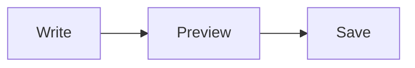

# Markdown Cheat Sheet

Use this as a quick reference while writing in mdit.

[Close Cheatsheet](#close-cheatsheet)

## Headings

# Heading 1
## Heading 2
### Heading 3
#### Heading 4

## Emphasis

*Italic text* and _also italic text_  
**Bold text** and __also bold text__  
***Bold italic text***  
~~Strikethrough~~

## Lists

- Item one
- Item two
  - Nested item
  - Another nested item

1. First
2. Second
3. Third

## Links and Images

[Visit Wails](https://wails.io)


## Blockquote

> Markdown blockquotes are useful for tips, notes, or callouts.

## Inline and Block Code

Use `inline code` in normal text.

```go
func main() {
    println("hello")
}
```

## Tables

| Name  | Value |
|-------|-------|
| Alpha | 1     |
| Beta  | 2     |

## Task Lists

- [x] Build viewer
- [ ] Add keyboard shortcuts

## Math

Inline: $E = mc^2$

$$
\sum_{i=1}^{n} i = \frac{n(n+1)}{2}
$$

## Diagrams



## Horizontal Rule

---

[Close Cheatsheet](#close-cheatsheet)
